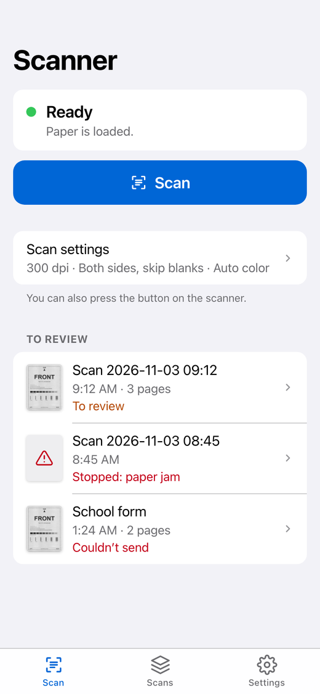
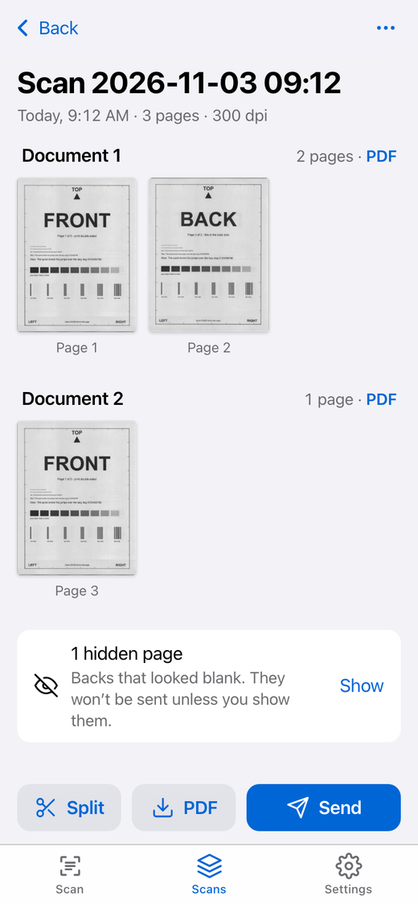
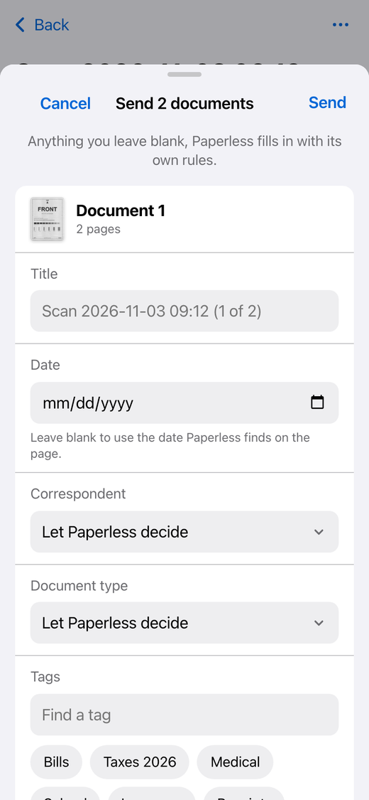

# Doxie Scanner

Run a **Doxie Pro DX400** from a Raspberry Pi and send what you scan to
[Paperless-ngx](https://docs.paperless-ngx.com/). You scan from your
phone (or press the button on the scanner), check and fix the pages,
split a stack into separate documents, and send them to Paperless. You
don't need Doxie's app or a computer.

<p>
  
  
  
</p>

This is a fork of [andiapps-dev/doxie-scanner](https://github.com/andiapps-dev/doxie-scanner).
The scanner driver has been rewritten to use the scanner's built-in
JPEG mode, which is several times faster than reading raw pixels. The
web app was rebuilt for phones, and Paperless support was added.

> Not affiliated with, endorsed by, or sponsored by Doxie, Apparent
> Corp., or Avision. "Doxie" and "Doxie Pro" are trademarks of their
> respective owners, named here only to describe hardware compatibility.

## What it does

- **Scan** from any phone, tablet or laptop on your network, or press
  the button on the scanner. Button scans wait under *To review* until
  someone checks and sends them; nothing goes to Paperless by itself.
- **Scan settings:** 200, 300 or 600 dpi. Choose one side, both sides,
  or *Auto*, which scans both sides and hides backs that look blank.
  Hidden pages are kept, so you can bring one back. Color can be color,
  gray, black & white, or *Auto*, which picks per page.
- **Fix pages:** rotate, crop, brightness, contrast, color mode, hide,
  delete. Edits never change the scan itself, so you can always undo
  them.
- **Put pages in order** by dragging them in a list, or a page at a time
  from the page viewer. A hidden blank back moves with its page.
- **Split** a stack into several documents by tapping between pages.
- **Combine two scans** into one, for a stack that went through as two
  scans after a jam or through two feeders. The older scan's pages come
  first.
- **Send to Paperless** with a title, date, correspondent, document type
  and tags picked from your Paperless lists. Anything left blank is up
  to Paperless's own matching rules. The app follows each upload until
  Paperless has filed it, then links to the document.
- **Download PDFs** straight to your phone: the whole scan, one
  document, or a single page. On an iPhone, open the PDF and choose
  Share → Save to Files.
- **Clean up after itself:** once Paperless has filed every page of a
  scan, the scan is deleted after 7 days. You can change this to 1 or
  30 days, or keep scans forever. Scans you haven't sent are never
  deleted.

On a laptop, the scan list sits beside the open scan, and light and
dark mode follow your device.

## What you need

- A Doxie Pro DX400 (USB ID `2740:000c`). Other Doxie models won't work.
- A Raspberry Pi 3B or newer running Raspberry Pi OS Lite (64-bit is
  best), or any other Linux machine that runs Docker.
- Paperless-ngx somewhere on your network. It's optional: without it,
  you can still scan and download PDFs.

## Set it up on a Raspberry Pi

1. Install **Raspberry Pi OS Lite** with
   [Raspberry Pi Imager](https://www.raspberrypi.com/software/). In its
   settings, set a hostname (say `scanner`) and turn on SSH.

2. Install Docker using Docker's convenience script, then let your user
   run it:

   ```bash
   curl -fsSL https://get.docker.com | sh
   sudo usermod -aG docker $USER   # then log out and back in
   ```

3. Get this repository and add your Paperless details:

   ```bash
   git clone https://github.com/jasonlearst/doxie-scanner.git
   cd doxie-scanner
   cp .env.example .env
   nano .env
   ```

   The token is in Paperless under your name (top right) → *My Profile*
   → *API Auth Token*.

4. Plug in the scanner, switch it on, and check that the Pi sees it:

   ```bash
   lsusb -d 2740:000c
   ```

5. Build and start the app. The first build on a Pi 3B takes a while.

   ```bash
   docker compose up -d --build
   ```

6. On your phone, open `http://scanner.local:8080`, or use the Pi's IP
   address. To get an app icon, use *Add to Home Screen*.

To update later, run `git pull && docker compose up -d --build`.

The app keeps its scans in `./data`. It has no login, so keep it on
your home network.

### USB access

The Compose file passes USB through with a bind mount and a device
cgroup rule (`c 189:* rmw`), not `devices:`. When the scanner switches
itself off and on again it gets a new USB device number. A `devices:`
entry only grants access to the number that existed when the container
started, so after that the app would see the scanner but couldn't open
it. Major number 189 covers all USB devices, and the wildcard covers
whatever number the scanner gets next. The rule can't be narrowed to
just this scanner: cgroup rules match device numbers, not USB IDs.

The container runs as root, so it can open the device node. To run it
as a normal user instead, install `udev/99-doxie-scanner.rules` on the
host. The rule makes the scanner's device node readable and writable by
everyone.

## Using the scanner

- **If the scanner has switched itself off** after sitting idle, the app
  shows *Off*. Press the scanner's power button and the app reconnects
  by itself.
- **All three paper paths work:** the top tray, the slot at the back,
  and the tray at the front.
- **A sheet left sitting in the front tray for about a minute** can
  make the scanner report a jam. Put paper in and scan straight away.
- **After a jam,** open the scanner, take the sheet out, and switch it
  off and on.

## Configuration

| Variable | Default | Purpose |
|---|---|---|
| `DOXIE_PAPERLESS_URL` | | Paperless-ngx address. Set this and the token to enable sending. |
| `DOXIE_PAPERLESS_TOKEN` | | Paperless API token. |
| `DOXIE_DATA_DIR` | `/data` | Where scans are kept. Must be writable. |
| `DOXIE_LISTEN_ADDR` | `:8080` | HTTP listen address. |
| `DOXIE_DRIVER` | `doxie-dx400` | Which scanner driver to use. |

Everything else, such as the button's scan settings and how long filed
scans are kept, is set in the app under Settings.

## How it works

The DX400 is Avision hardware. Doxie's own drivers talk to it with a
vendor set of 12-byte commands, in which the scanner compresses each
side to JPEG itself. That's what this driver uses. A 300 dpi duplex
sheet takes about 6.5 seconds.

The command sequence was worked out from USB captures of Doxie's
official app scanning on Windows (USBPcap), then rewritten from scratch.
No vendor or SANE code is included. Some details:

- Commands go out as vendor control transfers. Data comes back over
  bulk endpoint `0x81`, and button presses arrive on interrupt endpoint
  `0x83`.
- The scanner sends bare JPEG scan data. The driver adds the headers
  around it: quantization tables captured per resolution, the standard
  Huffman tables, and a 4:2:2 frame header that crops the scanner's
  padding.
- In duplex scans, the scanner alternates front and back chunks. The
  sense data after each side's last chunk says how many bytes and lines
  that side had.
- 200 dpi is read at 300 × 200 dpi. The app squares the pixels when it
  displays or exports the page.

The scanner's original JPEGs are stored untouched. Edits are saved as
settings and applied when a page is shown or exported. A PDF of
unedited pages embeds the original JPEGs, with no re-compression.
Black-and-white pages go in as PNG.

| Package | What it does |
|---|---|
| `internal/doxiedx400` | The DX400 driver: commands, scan window, JPEG headers, duplex, button |
| `internal/scsiusb` | USB transport: command/status/sense exchange, libusb adapter |
| `internal/scanjobs` | The one loop that owns the scanner: reconnects, button, scans |
| `internal/pageimage` | Blank-page and color detection, non-destructive edits |
| `internal/storage` | Scans on disk (`meta.json` plus original JPEGs), settings |
| `internal/paperless` | Paperless-ngx API client |
| `internal/housekeeping` | Follows uploads, deletes filed scans after the retention period |
| `internal/pdfexport` | PDF assembly |
| `internal/api` | HTTP API |
| `internal/web/static` | The web app: plain HTML, CSS and JavaScript, with no build step |

## Development

You need Go 1.26 or newer, a C compiler, and libusb-1.0 with pkg-config:
`libusb-1.0-0-dev` on Debian and Ubuntu, `brew install libusb pkg-config`
on macOS. The app also runs on macOS, which is handy with the scanner
plugged into a laptop:

```bash
DOXIE_DATA_DIR=./data DOXIE_LISTEN_ADDR=127.0.0.1:8080 go run .
```

`./test.sh` runs `go vet`, the tests, and the same coverage gate as CI
(at least 95%, not counting `internal/scsiusb/usbdevice.go`, which only
talks to real hardware). Everything else is tested against fake
scanners and a fake Paperless.

The real scanner has its own test, which doesn't run by default:

```bash
DX400_RES=300 DX400_DUPLEX=1 DX400_OUT=/tmp/dx400 \
  go test -tags hardware -run TestHardwareScan -v ./internal/doxiedx400
```

### API

Everything is JSON unless noted. There's no authentication.

| Endpoint | Purpose |
|---|---|
| `GET /api/scanner/status` | Connected, scanning, paper loaded, or why the scanner can't be reached |
| `GET /api/scan-options` | Resolutions and defaults |
| `GET`, `PUT /api/settings` | Button scan settings and `retentionDays` (0 keeps scans forever) |
| `POST /api/scans` | Start a scan: `{"resolution": 300, "sides": "auto", "color": "auto"}` |
| `GET /api/scans` | All scans, newest first |
| `GET`, `PATCH`, `DELETE /api/scans/{id}` | One scan; `PATCH` takes `name` and `splits` |
| `GET /api/scans/{id}/pdf` | PDF download; `?pages=001f,001b` limits it to those pages |
| `POST /api/scans/{id}/combine` | Move another scan's pages into this one and delete it: `{"from": "<scan id>"}` |
| `PUT /api/scans/{id}/pages/order` | Set the order of every page, hidden ones included |
| `POST /api/scans/{id}/pages/{page}/move` | Move a visible page next to another: `{"after": "<page id>"}` or `{"before": "<page id>"}` |
| `PATCH`, `DELETE /api/scans/{id}/pages/{page}` | Edit (`rotation`, `crop`, `brightness`, `contrast`, `color`, `hidden`) or delete a page |
| `GET /api/scans/{id}/pages/{page}/image` | Rendered page: `?size=thumb` or `preview`, `&crop=none` |
| `GET /api/scans/{id}/pages/{page}/original` | The scanner's JPEG, untouched |
| `POST /api/scans/{id}/send` | Send documents to Paperless |
| `POST /api/scans/{id}/sent/refresh` | Ask Paperless about uploads still in progress |
| `GET /api/paperless`, `/api/paperless/metadata` | Connection status; tags, correspondents and document types |
| `GET /api/version` | The release this build came from |

In `GET /api/scans/{id}`, each back has `blank`, `hidden` and `ink`.
`ink` is what decided `blank`: `sheet` is the share of the sheet darker
than paper, and `densest` the share in its most printed half-inch. A
back is blank only when both are low. Scans saved before `ink` was
recorded don't have it.

Errors look like `{"error": {"code": "no_paper", "message": "..."}}`.

## Releasing

Releases are `vX.Y.Z` git tags. Add a `## [X.Y.Z]` section to
[CHANGELOG.md](CHANGELOG.md) first; it becomes the release notes, and
the release fails without it. Pushing the tag runs CI, then builds the
image for amd64, arm64 and arm/v7, pushes it to
`ghcr.io/<owner>/doxie-scanner`, and creates a GitHub release. A plain
push to `main` only runs CI.

## License

MIT; see [LICENSE](LICENSE).

Uses [google/gousb](https://github.com/google/gousb) (Apache-2.0),
[disintegration/imaging](https://github.com/disintegration/imaging)
(MIT), [go-pdf/fpdf](https://github.com/go-pdf/fpdf) (MIT) and
[Cropper.js](https://fengyuanchen.github.io/cropperjs/) (MIT).
